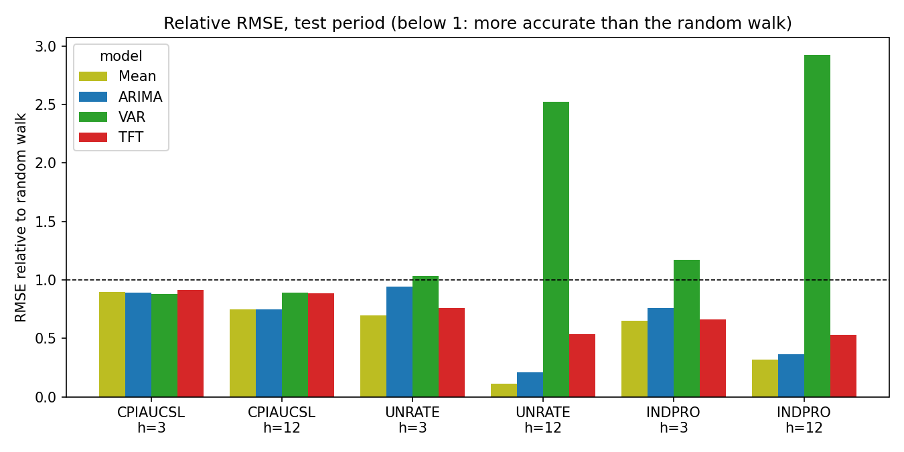

# tft-macro-forecasting

Does a deep-learning forecaster beat simple econometric benchmarks on US macroeconomic data?

This project compares a Temporal Fusion Transformer (TFT; Lim et al., 2021) with a random walk, a
historical-mean forecast, ARIMA and a small VAR for 3- and 12-month-ahead forecasts of US CPI inflation,
the unemployment rate and industrial production, using the FRED-MD database (McCracken & Ng, 2016).
Models are fitted on 1990–2017, tuned on 2018–2019 and evaluated once on 2020–2024.

**Author:** Victor Grzeszick, Felix-Hausdorff-Gymnasium Bonn.
**Full write-up:** [`docs/report.md`](docs/report.md).

## Result

Test period 2020–2024, RMSE relative to the random walk (below 1 is better than the random walk):

| Target | h | Mean | ARIMA | VAR | TFT |
|---|---|---|---|---|---|
| CPI inflation | 3 | 0.894 | 0.893 | 0.880 | 0.914 |
| CPI inflation | 12 | 0.750 | 0.749 | 0.892 | 0.885 |
| Unemployment (Δ) | 3 | 0.696 | 0.945 | 1.033 | 0.759 |
| Unemployment (Δ) | 12 | 0.111 | 0.207 | 2.521 | 0.534 |
| Industrial production | 3 | 0.650 | 0.758 | 1.174 | 0.663 |
| Industrial production | 12 | 0.321 | 0.363 | 2.926 | 0.528 |

- The TFT is **not significantly more accurate than a random walk** for any target or horizon
  (Diebold-Mariano p between 0.28 and 0.61) and never beats the historical mean.
- For inflation twelve months ahead, **ARIMA is significantly more accurate than the TFT** (p = 0.011).
- The historical mean is the best or near-best forecast everywhere: at these horizons the series were
  essentially unpredictable, so a model with 102,000 parameters had nothing to add.
- Unemployment and industrial-production results are dominated by the COVID-19 shock of 2020.



## Repository layout

| Path | Content |
|---|---|
| `data/raw/fred_md.csv` | FRED-MD vintage downloaded 2026-05-10 (committed, because FRED-MD is revised monthly) |
| `src/config.py` | all design choices in one place: periods, targets, horizons, TFT settings |
| `src/build_dataset.py` | step 1: applies the FRED-MD transformation codes |
| `src/data_pipeline.py` | step 2: builds the 1990–2024 panel, ADF tests |
| `src/baselines.py` | step 3: walk-forward RW, Mean, ARIMA and VAR forecasts |
| `src/tft_data.py`, `src/tft_train.py` | step 4: TFT datasets, hyperparameter grid and training |
| `src/tft_predict.py` | step 5: TFT forecasts, variable importance, attention |
| `src/evaluate.py` | step 6: RMSE, MAE, Diebold-Mariano tests |
| `src/plots.py` | step 7: figures |
| `tests/` | unit tests (transformations, splits, look-ahead checks, DM test) |
| `results/` | every number in the report, as CSV; `results/summary.md` holds the main tables |
| `models/` | trained TFT checkpoints (seed 42) |
| `figures/` | figures used in the report |
| `docs/report.md` | the report |
| `paper/spec.md` | the original specification and its dated amendments |
| `notes/` | lab notes and reading notes from the working process (historical) |

## Reproducing the results

Requires Python 3.11.

```bash
git clone https://github.com/victor-grzeszick/tft-macro-forecasting.git
cd tft-macro-forecasting
python3.11 -m venv .venv
source .venv/bin/activate
pip install -r requirements.txt
bash scripts/reproduce.sh
```

`scripts/reproduce.sh` runs the unit tests and then steps 1–7 with the committed TFT checkpoints (about a
minute on a laptop CPU). `bash scripts/reproduce.sh --retrain` also repeats the hyperparameter search and
retrains all TFT models for five seeds (about fifteen minutes). Baseline results are deterministic.
Retrained networks can differ in the last digits across machines; the committed checkpoints reproduce
the reported TFT numbers.

Each step can also be run on its own, e.g. `python src/evaluate.py`. Steps 3, 5, 6 and 7 accept
`--until val`, which stops before the test period; this is how the pipeline was developed without looking
at test data.

## Acknowledgement

The research question, the choice of data, targets and models, and the original implementation (May–July
2026) are my own. An AI assistant (Claude) was used in October–November 2026 to audit the code, rewrite the
pipeline, add the robustness checks and unit tests, run the final evaluation and draft the documentation;
this is visible in the commit history.

## References

- Diebold, F. X., & Mariano, R. S. (1995). Comparing predictive accuracy. *Journal of Business & Economic Statistics*, 13(3), 253–263.
- Harvey, D., Leybourne, S., & Newbold, P. (1997). Testing the equality of prediction mean squared errors. *International Journal of Forecasting*, 13(2), 281–291.
- Lim, B., Arık, S. Ö., Loeff, N., & Pfister, T. (2021). Temporal Fusion Transformers for interpretable multi-horizon time series forecasting. *International Journal of Forecasting*, 37(4), 1748–1764.
- McCracken, M. W., & Ng, S. (2016). FRED-MD: A monthly database for macroeconomic research. *Journal of Business & Economic Statistics*, 34(4), 574–589.
- Stock, J. H., & Watson, M. W. (2007). Why has U.S. inflation become harder to forecast? *Journal of Money, Credit and Banking*, 39(s1), 3–33.
