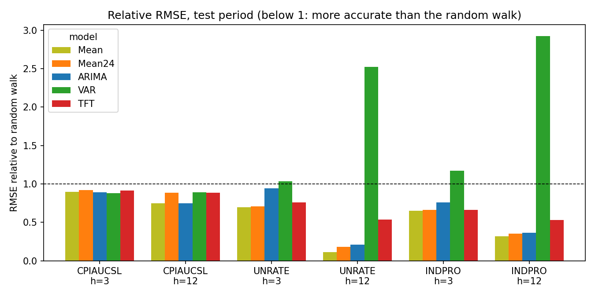
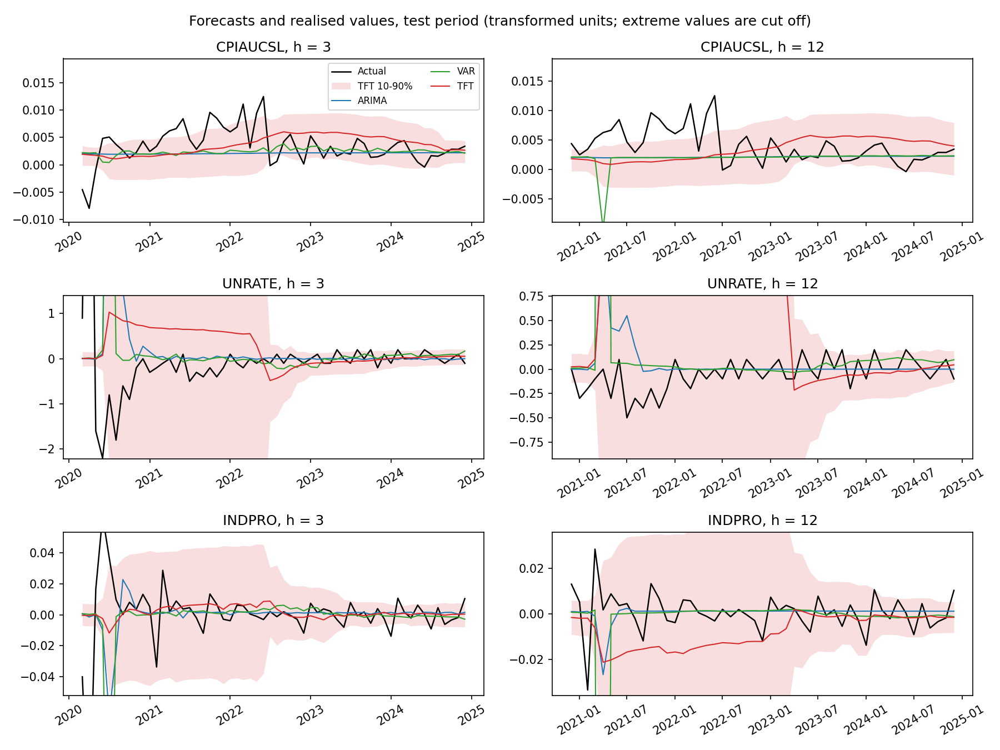
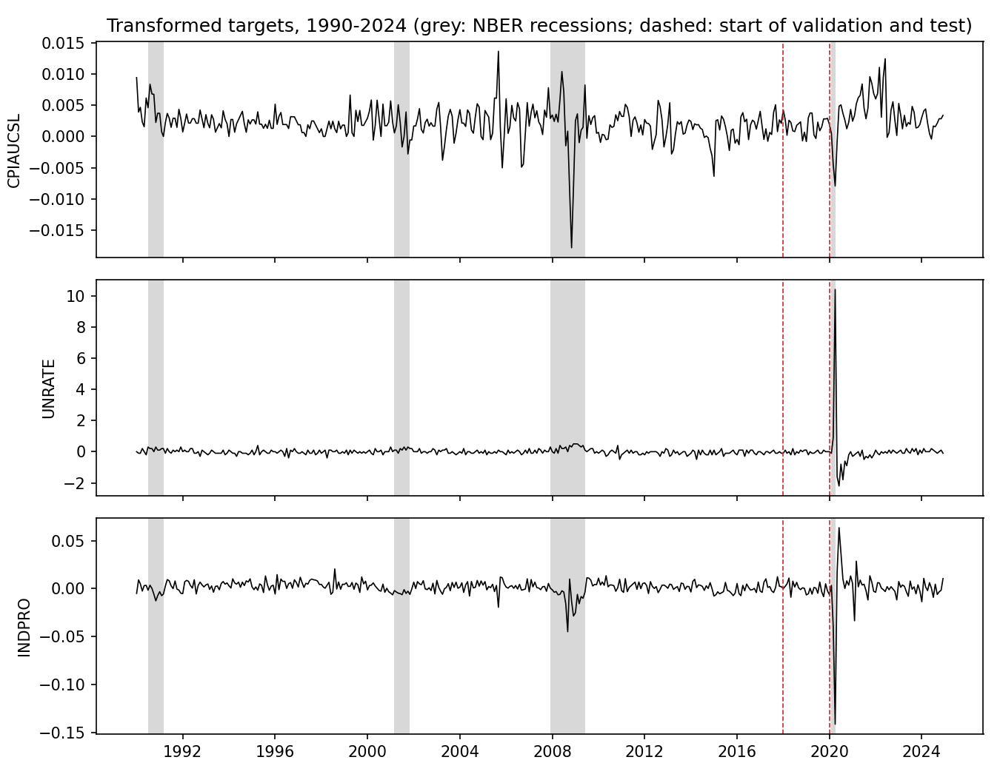
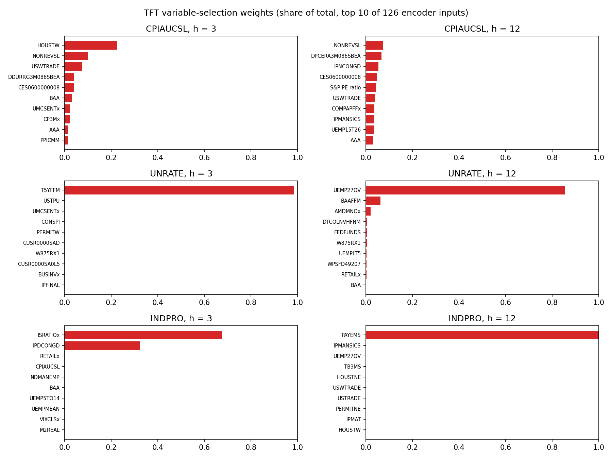

# Does a Temporal Fusion Transformer forecast US macroeconomic series better than classical benchmarks?

**Victor Grzeszick** · Felix-Hausdorff-Gymnasium Bonn · November 2026

## Abstract

I compare a Temporal Fusion Transformer (TFT), a deep-learning model for time series, with a random walk, a
historical-mean forecast, ARIMA and a vector autoregression for forecasting US CPI inflation, the change
in the unemployment rate and industrial-production growth three and twelve months ahead. Models are
specified on FRED-MD data for 1990–2017, tuned on 2018–2019 and evaluated once, walk-forward, on
2020–2024. The TFT is not significantly more accurate than a random walk for any target or horizon and
never improves on the historical mean. For inflation twelve months ahead, ARIMA, which at that horizon is
practically a constant forecast, is significantly more accurate than the TFT (Diebold-Mariano p = 0.011),
although the VAR pre-selected for that comparison is not. A diagnostic shows why the TFT adds nothing: most
of the trained networks produce an output that does not depend on their inputs, so the TFT behaves like a
24-month rolling mean, and its variable-selection weights carry no information. The findings are
consistent with the view that these series are close to unforecastable at such horizons, and that with
about 300 training observations a large model has nothing to learn that a constant does not already
capture.

## 1. Introduction

Forecasts of inflation, unemployment and output growth are inputs to monetary policy and to most
investment decisions. For decades the standard tools have been small linear time-series models: univariate
ARIMA models and vector autoregressions (VARs). These models are hard to beat. Stock and Watson (2007) show
that for US inflation even sophisticated models rarely improve on simple univariate benchmarks, and
Atkeson and Ohanian (2001) find that a naive forecast matches Phillips-curve models.

Deep learning offers an alternative. The Temporal Fusion Transformer (TFT; Lim et al., 2021) combines
recurrent layers, an attention mechanism and a learned variable-selection step. It can use many predictors
at once, produces forecast intervals, and reports which inputs it relied on. FRED-MD (McCracken and Ng,
2016), a monthly database of about 126 US series, is a natural test bed: it has many predictors but only a
few hundred observations per series, which is small by deep-learning standards.

This report asks one question: **does a TFT that sees all FRED-MD series produce more accurate 3- and
12-month-ahead forecasts of US CPI inflation, the unemployment rate and industrial production than a random
walk, an ARIMA model and a small VAR?** The emphasis is on making the comparison fair. Every forecast uses
only information available at the time it is made, all model choices are fixed on data up to 2019, and the
2020–2024 test period was evaluated once, after the pipeline had been frozen.

## 2. Data

### 2.1 Source

The data are the FRED-MD file `current.csv`, downloaded on 10 May 2026 from the St. Louis Fed
(observations 1959-01 to 2026-03, 126 series). FRED-MD is re-issued every month with revised values, so the
file is stored in the repository (`data/raw/fred_md.csv`) and all results refer to this vintage.

### 2.2 Transformations and targets

Most macroeconomic series trend upwards and are therefore non-stationary: their mean changes over time, and
regressions between such series can find relationships that do not exist. FRED-MD assigns each series a
transformation code that removes the trend (for example 2 = first difference, 5 = first difference of the
logarithm). I apply these codes with one exception, which gives the three targets:

| Target | Series | Transformation | Meaning |
|---|---|---|---|
| Inflation | CPIAUCSL | code 5: Δ log | monthly CPI inflation rate |
| Unemployment | UNRATE | code 2: Δ | monthly change in the unemployment rate (percentage points) |
| Output | INDPRO | code 5: Δ log | monthly growth of industrial production |

McCracken and Ng use code 6 (the *change* in inflation) for CPI. I use code 5 so that the target is the
inflation rate itself, which is easier to interpret. Industrial production stands in for GDP, which is
only available quarterly.

Augmented Dickey-Fuller tests on the training sample reject a unit root for all five variables used in the
VAR (Table 1), although only at the 5% level for the term spread.

**Table 1. ADF tests, 1990-01 to 2017-12** (`results/adf_tests.csv`)

| Series | ADF statistic | p-value |
|---|---|---|
| CPIAUCSL (Δ log) | −6.04 | < 0.001 |
| UNRATE (Δ) | −3.62 | 0.005 |
| INDPRO (Δ log) | −4.93 | < 0.001 |
| FEDFUNDS (Δ) | −4.56 | < 0.001 |
| T10YFFM (level) | −2.87 | 0.048 |

### 2.3 Sample

The estimation panel runs from 1990-01 to 2024-12 (420 months). One series (ACOGNO) is dropped because more
than 5% of its training observations are missing, leaving 125 series. Three missing cells in 2020 (CP3Mx in
April and May, COMPAPFFx in April) are filled with the previous month's value. The sample is split by time:

| Period | Months | Use |
|---|---|---|
| Training | 1990-01 to 2017-12 (336) | estimation |
| Validation | 2018-01 to 2019-12 (24) | early stopping, hyperparameters, choice of best baseline |
| Test | 2020-01 to 2024-12 (60) | final evaluation, used once |

A random split would be invalid for time series: neighbouring months are correlated, so a model trained on
randomly chosen months would effectively have seen the months it is tested on.

## 3. Forecasting design

### 3.1 Forecast definition

At the end of month *t* (the forecast origin) each model forecasts the value of the transformed target in
month *t + h*, for *h* = 3 and *h* = 12, using only data up to and including *t*. The target is the monthly
value *h* months ahead, not the cumulative change over the next *h* months.

Forecasts are produced walk-forward (rolling origin): the origin moves forward one month at a time. A
forecast is counted in a period only if its origin is no earlier than the last month before that period.
For the test period this means origins from 2019-12 on, giving 58 forecasts at *h* = 3 (targets 2020-03 to
2024-12) and 49 at *h* = 12 (targets 2020-12 to 2024-12); for validation, 22 and 13. No forecast is
therefore made from inside a sample that was used to fit or select the model.

Data are final revised values, not the real-time vintages a forecaster would have had (see Section 6).

### 3.2 Benchmarks

- **Random walk (RW):** the forecast is the last observed value, ŷ(t+h) = y(t).
- **Historical mean (Mean):** the forecast is the average of all observations up to *t*. For a stationary
  series this is the forecast one would make if the past contained no usable information beyond the mean.
- **ARIMA(p, 0, q):** a univariate model in which the series depends on its own *p* past values and *q*
  past forecast errors. Orders are chosen per target by stepwise AIC search on the training sample
  (`pmdarima.auto_arima`); no differencing is applied because the targets are already stationary.
- **VAR(p):** each of five variables (the three targets, the federal funds rate and the 10-year-minus-
  federal-funds term spread) is regressed on *p* lags of all five. The lag length is chosen by BIC on the
  training sample.

Selected specifications (`results/baseline_specs.json`): ARMA(0, 2) with constant for CPIAUCSL,
ARMA(5, 1) without constant for UNRATE, AR(4) with constant for INDPRO, and a VAR(1) (BIC selects one lag;
AIC three).

For inflation the selected model has no autoregressive part, so its forecasts beyond two months ahead equal
its estimated constant; at both horizons it is in effect a mean forecast (Section 4.3).

Orders and lag length are fixed after the training sample. The parameters of ARIMA and VAR are re-estimated
at every origin on all data up to that origin (expanding window), which is standard practice in
econometric forecast evaluation.

### 3.3 Temporal Fusion Transformer

The TFT is implemented with `pytorch-forecasting`. One model is trained per target and horizon (six in
total), mirroring the per-series benchmarks. Its main components are:

1. **Variable selection network.** For each month, a small network assigns a weight to each of the 126
   inputs (125 series plus the position in the window), and the model works with the weighted combination.
   The weights sum to one and can be read as variable importances.
2. **LSTM encoder–decoder.** A recurrent network reads the 24 months before the origin (encoder) and then
   steps through the *h* forecast months (decoder), carrying a summary of the past.
3. **Multi-head attention.** For each forecast month the model computes weights over all past months and
   takes a weighted average of their representations, so it can draw directly on any earlier month.
4. **Gated residual networks.** Skip connections with learned gates let the model bypass components it
   does not need, which matters when data are scarce.
5. **Quantile outputs.** The model outputs the 10%, 50% and 90% quantiles and is trained with the quantile
   (pinball) loss. The median is used as the point forecast.

All 125 series enter as past-observed inputs. The 124 series other than the target are standardised with
means and variances from the training sample. The target, both as an input and as the quantity to be
predicted, is standardised within each 24-month encoder window (the library's default for a single series).
The encoder length of 24 months was fixed in advance and not tuned.

**Training.** Models are trained on 1990–2017 (310 samples at *h* = 3, 301 at *h* = 12) with the Adam
optimiser, batch size 64 and seed 42. Training stops when the validation loss has not improved for 15
epochs, and the weights of the best validation epoch are kept. The loss is averaged over all decoder months
*t* + 1 to *t* + *h*, although only the forecast for *t* + *h* is evaluated. Weights are then frozen: the same model
produces all validation and test forecasts.

**Tuning.** Hidden size {8, 16, 32}, dropout {0.1, 0.2} and learning rate {0.01, 0.03} were searched in a
12-point grid on one model (UNRATE, *h* = 3), and the configuration with the lowest validation loss was
applied to all six models. The selected configuration is hidden size 16, dropout 0.2 and
learning rate 0.03 (about 102,000 parameters). Validation loss varied by only 3% across the grid
(`results/tuning_grid.csv`), so the data do not clearly favour any configuration.

### 3.4 Evaluation

Accuracy is measured by the root mean squared error (RMSE) and the mean absolute error (MAE). RMSE is also
reported relative to the random walk, so that values below one mean the model is more accurate.

A lower RMSE in one sample can be due to chance. The **Diebold-Mariano (DM) test** asks whether the
difference in accuracy between two models is statistically significant. For each month it takes the
difference between the two models' squared errors, d(t) = e₁(t)² − e₂(t)², and tests whether the mean of
d is zero. Because *h*-step forecast errors overlap and are therefore correlated up to lag *h* − 1, the
variance of the mean is estimated with autocovariances up to that lag. I apply the small-sample correction
of Harvey, Leybourne and Newbold (1997) and compare the statistic with a Student-*t* distribution with
*n* − 1 degrees of freedom. A negative statistic means the first-named model is more accurate.

Three robustness checks were specified before the test run: (i) ARIMA and VAR with parameters frozen at
the end of the training sample, which is the like-for-like comparison with the TFT's frozen weights; (ii)
four further random seeds for the TFT and the average (ensemble) of all five; (iii) the test period
without 2020.

## 4. Results

### 4.1 Validation period (2018–2019)

Table 2 reports validation RMSE relative to the random walk. These numbers were used for early stopping,
tuning and choosing the best baseline, so they are optimistic and serve only as a plausibility check. Apart
from the random walk, the models are close to one another; the largest gap, the TFT's 14% advantage over
the historical mean for industrial production at *h* = 12, rests on 13 forecasts.

**Table 2. Validation RMSE relative to the random walk** (`results/metrics.csv`)

| Target | h | n | RW RMSE | Mean | ARIMA | VAR | TFT |
|---|---|---|---|---|---|---|---|
| CPIAUCSL | 3 | 22 | 0.00226 | 0.618 | 0.620 | 0.667 | 0.626 |
| CPIAUCSL | 12 | 13 | 0.00229 | 0.652 | 0.653 | 0.653 | 0.642 |
| UNRATE | 3 | 22 | 0.173 | 0.635 | 0.674 | 0.646 | 0.638 |
| UNRATE | 12 | 13 | 0.164 | 0.582 | 0.579 | 0.580 | 0.579 |
| INDPRO | 3 | 22 | 0.00627 | 0.882 | 0.832 | 0.854 | 0.852 |
| INDPRO | 12 | 13 | 0.00738 | 0.744 | 0.755 | 0.717 | 0.639 |

Training gave an early warning. The validation loss reached its minimum after only 4 to 13 epochs in five
of the six models (34 in the sixth) and then rose, which suggests that the network found little
generalisable signal before it began to fit noise.

### 4.2 Test period (2020–2024)

**Table 3. Test RMSE relative to the random walk** (`results/metrics.csv`; lowest value per row in bold).
Mean24 is the 24-month rolling mean, a diagnostic benchmark added after the test run (Section 4.5).

| Target | h | n | RW RMSE | Mean | ARIMA | VAR | TFT | Mean24 |
|---|---|---|---|---|---|---|---|---|
| CPIAUCSL | 3 | 58 | 0.00406 | 0.894 | 0.893 | **0.880** | 0.914 | 0.919 |
| CPIAUCSL | 12 | 49 | 0.00470 | 0.750 | **0.749** | 0.892 | 0.885 | 0.885 |
| UNRATE | 3 | 58 | 2.093 | **0.696** | 0.945 | 1.033 | 0.759 | 0.711 |
| UNRATE | 12 | 49 | 1.570 | **0.111** | 0.207 | 2.521 | 0.534 | 0.182 |
| INDPRO | 3 | 58 | 0.0358 | **0.650** | 0.758 | 1.174 | 0.663 | 0.665 |
| INDPRO | 12 | 49 | 0.0274 | **0.321** | 0.363 | 2.926 | 0.528 | 0.352 |

Three observations stand out (see also Figure 1).

*The TFT does not improve on the simple benchmarks.* Its RMSE is below that of the random walk in all six
cases, but it is never the most accurate model, and in every case the historical mean is more accurate.

*The historical mean is the hardest benchmark to beat.* It has the lowest RMSE in four of six cases and
is within 2% of the best model in the other two. No model in Table 3 improves on a constant forecast by
more than 2%: at horizons of three months and more, the month-to-month movements of these series were
essentially unpredictable from the information used.

*The random walk is a weak benchmark for growth rates.* If a series fluctuates unpredictably around a
constant mean with variance σ², the mean forecast has error variance σ², whereas the random walk forecast
y(t) has error variance 2σ², because it adds the noise of the last observation to the noise of the outcome.
Its RMSE is then √2 times larger, so a ratio of about 0.71 against the random walk reflects no forecasting
skill at all. Beating the random walk, as all models do, is therefore not evidence of predictive ability.

The very large and very small ratios for unemployment and industrial production are caused by the COVID-19
shock. In April 2020 the unemployment rate rose by 10.4 percentage points in one month, about sixty times
the random walk's validation RMSE. Any model that carries this observation forward performs badly: the
random walk repeats it three and twelve months later, and the re-estimated VAR extrapolates it
(Section 4.4).

### 4.3 Statistical significance

**Table 4. Diebold-Mariano tests of the TFT against each benchmark, test period** (`results/dm_tests.csv`)

HLN-corrected statistic with two-sided p-value in parentheses. Negative values: the TFT has the lower
squared error. † marks the classical baseline with the lowest validation RMSE, the comparison named in the
specification. \*\* p < 0.05.

| Target | h | n | vs RW | vs Mean | vs ARIMA | vs VAR |
|---|---|---|---|---|---|---|
| CPIAUCSL | 3 | 58 | −0.52 (0.607) | 0.29 (0.772) | 0.31 (0.758)† | 0.56 (0.579) |
| CPIAUCSL | 12 | 49 | −0.63 (0.532) | 2.60\*\* (0.012) | 2.64\*\* (0.011) | −0.05 (0.963)† |
| UNRATE | 3 | 58 | −0.90 (0.374) | 2.14\*\* (0.037) | −0.85 (0.398) | −0.89 (0.378)† |
| UNRATE | 12 | 49 | −0.71 (0.479) | 1.46 (0.152) | 1.45 (0.153)† | −0.85 (0.398) |
| INDPRO | 3 | 58 | −1.09 (0.282) | 0.74 (0.461) | −0.97 (0.337)† | −1.01 (0.319) |
| INDPRO | 12 | 49 | −0.87 (0.389) | 1.21 (0.231) | 1.22 (0.227) | −0.87 (0.389)† |

- **The TFT is not significantly more accurate than the random walk** for any target or horizon
  (p between 0.28 and 0.61), nor than any other benchmark in Table 4.
- **For inflation twelve months ahead, ARIMA and the historical mean are significantly more accurate than
  the TFT** (p = 0.011 and 0.012); the TFT's RMSE is 18% higher. These are one finding, not two. The
  selected inflation model is an MA(2) with a constant, and the forecast of an MA(2) more than two months
  ahead is simply its estimated constant. At both horizons the ARIMA forecast is therefore practically
  identical to the historical mean, and the result reads: *a constant forecast beats the TFT*.
- **Against the baseline pre-selected on validation data (†), no difference is significant.** For inflation
  at *h* = 12 that baseline is the VAR (p = 0.963), which had edged out ARIMA on 13 validation forecasts by
  a margin in the fourth decimal place. The inflation result therefore depends on which benchmark is
  regarded as the relevant one.

Three cautions apply. First, Table 4 contains 24 tests which are far from independent (the same TFT errors
enter every row, and several benchmarks are nearly the same forecast). At the 5% level one or two
rejections would be expected by chance, and none of the three would survive a Bonferroni correction
(0.05 / 24 ≈ 0.002). Second, large RMSE differences for unemployment and industrial production are *not*
significant, because they come from very few extreme months: the DM test recognises that a difference
driven by a handful of observations is weak evidence. Third, at *h* = 12 the variance estimate uses 11
autocovariances from 49 observations and is itself imprecise.

### 4.4 Robustness

**Frozen benchmarks.** The TFT's weights are fixed after 2017, while ARIMA and VAR are re-estimated every
month. Table 5 repeats the comparison with benchmark parameters frozen at the end of 2017.

**Table 5. Test RMSE relative to the random walk: re-estimated and frozen benchmarks**

| Target | h | ARIMA | ARIMA frozen | VAR | VAR frozen | TFT |
|---|---|---|---|---|---|---|
| CPIAUCSL | 3 | 0.893 | 0.900 | 0.880 | 0.891 | 0.914 |
| CPIAUCSL | 12 | 0.749 | 0.747 | 0.892 | 0.746 | 0.885 |
| UNRATE | 3 | 0.945 | 0.740 | 1.033 | 0.699 | 0.759 |
| UNRATE | 12 | 0.207 | 0.161 | 2.521 | 0.112 | 0.534 |
| INDPRO | 3 | 0.758 | 0.721 | 1.174 | 0.679 | 0.663 |
| INDPRO | 12 | 0.363 | 0.337 | 2.926 | 0.318 | 0.528 |

Re-estimation did not give the benchmarks an advantage over the TFT. For unemployment and industrial
production it hurt them: the re-estimated VAR is the worst model at *h* = 12 for these two targets, because
the 2020 observations distort its coefficients. A few months that are tens of standard deviations from the
mean dominate a least-squares fit; this is the problem analysed by Lenza and Primiceri (2022). With frozen
coefficients the VAR is as accurate as the historical mean. For inflation, freezing makes little difference
(at *h* = 3 the re-estimated models are slightly better). At *h* = 12 the frozen models are again close to
a constant, so their significant advantage over the TFT for inflation (p = 0.009 and 0.007) repeats the
finding of Section 4.3 and is not independent evidence.

**Random seeds.** Neural-network training depends on the random initialisation. Table 6 shows the range of
the TFT's relative RMSE over five seeds and the RMSE of the averaged (ensemble) forecast.

**Table 6. TFT test RMSE relative to the random walk across five seeds** (`results/seed_robustness.csv`)

| Target | h | Seed 42 | Minimum | Median | Maximum | Ensemble |
|---|---|---|---|---|---|---|
| CPIAUCSL | 3 | 0.914 | 0.914 | 0.916 | 0.923 | 0.917 |
| CPIAUCSL | 12 | 0.885 | 0.871 | 0.884 | 0.893 | 0.882 |
| UNRATE | 3 | 0.759 | 0.705 | 0.759 | 0.946 | 0.764 |
| UNRATE | 12 | 0.534 | 0.172 | 0.394 | 0.534 | 0.358 |
| INDPRO | 3 | 0.663 | 0.663 | 0.698 | 0.719 | 0.685 |
| INDPRO | 12 | 0.528 | 0.345 | 0.438 | 0.528 | 0.411 |

Inflation results barely depend on the seed, and the ensemble is also significantly less accurate than
the constant forecasts for inflation at *h* = 12 (p = 0.031 against ARIMA). For unemployment and industrial
production the spread is wide, and the pre-specified seed 42 happens to be the worst of five at *h* = 12;
some seeds rank ahead of ARIMA there (for example 0.172 against 0.207 for unemployment). One statement holds
for every seed in every row: the TFT does not beat the historical mean.

**Excluding 2020.** Dropping targets dated 2020 removes ten forecasts at *h* = 3 but only one at
*h* = 12 (whose test window starts in December 2020), so this check is informative only for *h* = 3
(n = 48; `results/metrics.csv`, period `test_ex2020`). Three things change.

- For inflation, the random walk becomes the most accurate model (all others have relative RMSE between
  1.03 and 1.11): during the 2021–2023 inflation surge, "inflation stays where it is" was a better forecast
  than "inflation returns to its mean".
- For unemployment, the seed-42 TFT is significantly *less* accurate than every benchmark (relative RMSE
  2.34; p between 0.026 and 0.042). This varies with the seed (relative RMSE from 0.97 to 3.33); the
  ensemble's relative RMSE is 2.04.
- For industrial production, the TFT ensemble is significantly more accurate than the random walk
  (relative RMSE 0.82, p < 0.001), while the seed-42 model is not (0.75, p = 0.149). This is the only
  significant result in the TFT's favour in the study, and it is against the weakest benchmark: the
  historical mean (0.72) is more accurate than both.

### 4.5 What the TFT learned

**The networks ignore their inputs.** The TFT standardises its target within each encoder window: it
subtracts the mean of the last 24 months and divides by their standard deviation, and it predicts in these
standardised units. Table 7 expresses each forecast in the same units, z = (forecast − 24-month mean) /
24-month standard deviation. If the network used its inputs, z would vary from month to month.

**Table 7. TFT forecasts in standardised units, seed 42, all validation and test origins**
(`results/tft_normalised_forecasts.csv`)

| Target | h | Mean of z | Standard deviation of z |
|---|---|---|---|
| CPIAUCSL | 3 | 0.102 | 0.0001 |
| CPIAUCSL | 12 | −0.003 | 0.0000 |
| UNRATE | 3 | 0.222 | 0.070 |
| UNRATE | 12 | 0.408 | 0.0005 |
| INDPRO | 3 | 0.019 | 0.187 |
| INDPRO | 12 | −0.332 | 0.045 |

In most models z is constant. Its standard deviation is below 0.01 in 20 of the 30 trained models (six
targets and horizons times five seeds) and below 0.05 in 23. Such a network outputs the same number
whatever it is shown, so its forecast is

  forecast = (mean of the last 24 months) + c × (standard deviation of the last 24 months),

with a constant *c* fixed during training. **The TFT has collapsed to a 24-month rolling mean with a small
offset; the 125 predictors play no role.** The Mean24 column of Table 3 confirms this: for inflation at
*h* = 12 the TFT and the plain rolling mean have the same relative RMSE (0.885), and they are close in
three further rows. This diagnostic and the Mean24 benchmark were added after the test evaluation, in
response to an independent review, and should be read as explanation rather than as pre-specified tests.

The collapse accounts for the other findings:

- *The inflation result.* "ARIMA beats the TFT" at *h* = 12 is a long-run mean beating a 24-month rolling
  mean. The rolling mean was pulled up by the 2021–2022 surge and then over-predicted inflation in
  2023–2024.
- *Outlier sensitivity.* After April 2020 the unemployment and industrial-production forecasts are shifted
  and the intervals very wide for about 24 months at *h* = 3 (Figure 2), the length of the encoder window:
  one extreme month moves the window mean and inflates the window standard deviation until it drops out.
  ARIMA recovers within a few months.
- *Seed dependence.* Seeds differ mainly in the offset *c*. Normally this hardly matters, but multiplied
  by a standard deviation inflated by the pandemic it does: for unemployment at *h* = 12, seed 42 has
  *c* = 0.41 (relative RMSE 0.534) and seed 46 has *c* = −0.02 (0.172, close to Mean24's 0.182).
- *Variable importance.* In several models the selection network puts almost all weight on one input
  (Figure 4), for example 96% on a Treasury spread for unemployment at *h* = 3. Across the five seeds the
  top-ranked variable differs in almost every case (`results/variable_importance.csv`): for inflation at
  *h* = 3 the seeds choose housing starts in the West, output of final products and nonindustrial supplies,
  housing starts in the South, the oil price and non-borrowed reserves. Since the output does not depend
  on the inputs, these weights carry no information. The interpretability that the TFT offers is only as
  good as the signal it has found.
- *Attention.* For the same reason average attention weights are close to uniform over the 24 months in
  most models (`figures/attention.png`).
- *Forecast intervals.* The quantiles are likewise fixed multiples of the window standard deviation. The
  10–90% interval should contain 80% of outcomes; on the test period it contains 84–92% for unemployment
  and industrial production (too wide while the 2020 outlier is in the window) and 67% for inflation (too
  narrow, because the window's standard deviation lagged behind the rise in inflation volatility).

*Figure 1. Test RMSE relative to the random walk.*

*Figure 2. Forecasts and realised values, test period. Axes are cut off at extreme values.*

*Figure 3. The three transformed targets, 1990–2024.*

*Figure 4. TFT variable-selection weights (seed 42).*

## 5. Discussion

The TFT did not forecast better than models with a handful of parameters. Three reasons seem most likely.

1. **There is little to predict.** If no model beats the historical mean, the limiting factor is the data,
   not the method. Stock and Watson (2007) document that US inflation has become hard to forecast better
   than simple univariate benchmarks, and Atkeson and Ohanian (2001) that a naive forecast (in their case
   the previous year's inflation rate) matches Phillips-curve models. Here the same holds for monthly
   changes in unemployment and output. A flexible model cannot extract a signal that is not there.
2. **Too few observations for the model's size.** The TFT has about 102,000 parameters and is trained on
   310 overlapping samples from 336 months; the VAR(1) has 30 coefficients. With so little data and so
   little signal, the best the network could do on the validation set was to ignore its inputs and output
   a constant. The comparison "TFT against benchmarks" then becomes "24-month rolling mean against
   long-run mean". Whether the rolling or the long-run mean is better is decided by the library's default
   way of scaling the target, not by the architecture.
3. **A structural break in the test period.** All model specifications were chosen on data up to 2019, a
   period of low and stable inflation. The pandemic and the subsequent inflation surge were unlike anything
   in that sample. Models reacted in different ways: re-estimated linear models were distorted by the
   outliers, the TFT by its normalisation window, and the long-run mean was unaffected by the shock but
   missed the surge.

A methodological lesson is that the choice of benchmark and of evaluation design decides the conclusion.
Measured against the random walk alone, every model "works". Measured against the historical mean, none
does. A headline such as "ARIMA significantly beats the neural network" turns out, on inspection, to be a
statement about two different averages. And an earlier version of this project, in which ARIMA had
accidentally been fitted on the validation data it was then scored on, biased the validation comparison in
ARIMA's favour. Making the comparison fair, and understanding what the models were actually doing,
required more care than building them.

## 6. Limitations

- **Revised data.** FRED-MD contains today's revised values. A real-time forecaster would have had earlier,
  noisier figures, and some series are published with a delay. The exercise is a pseudo-out-of-sample
  comparison, not a real-time one; this affects all models, but not necessarily equally.
- **One test period, dominated by one event.** Results for unemployment and industrial production are
  driven by a few months in 2020. With 49–58 overlapping forecasts the DM test has low power, so "not
  significant" must not be read as "equally good".
- **Multiple, dependent comparisons.** Many tests are reported; individual p-values near 0.01–0.05 are
  suggestive, not conclusive.
- **Small validation set.** Early stopping and tuning rely on 22 (*h* = 3) or 13 (*h* = 12) validation
  forecasts. The validation loss differed by only 3% across the whole tuning grid, which is no more than
  the variation across random seeds for a single configuration, so the selected configuration is close to
  arbitrary. The grid was small and was run on one target only.
- **Target definition.** The target is the monthly rate *h* months ahead. The average rate over the next
  *h* months, which is common in the literature, is smoother and may be more predictable.
- **TFT configuration.** The TFT was not re-trained during the test period, used no known future inputs
  (such as calendar variables), was trained on a loss averaged over all steps up to *h* although only step
  *h* is evaluated, and standardised the target within the encoder window. A different normalisation, an
  outlier treatment, fewer inputs or stronger regularisation might prevent the collapse described in
  Section 4.5; this was not explored, so the results describe this configuration, not the architecture in
  general.
- **ARIMA estimation.** Each monthly re-estimation starts from the previous month's parameters, and the
  optimiser did not always converge. For unemployment and industrial production after April 2020 the
  re-estimated ARIMA forecasts therefore depend somewhat on the optimiser's path. The inflation forecasts
  and all conclusions are unaffected, since the comparisons that matter are against the mean.
- **Scope.** One country, one data vintage, three targets, two horizons, one neural architecture. The
  crisis subsample (2008–2010) planned in the specification was not carried out.

## 7. Conclusion

On US monthly data from FRED-MD, a Temporal Fusion Transformer given 125 predictors did not produce more
accurate 3- and 12-month-ahead forecasts of inflation, unemployment changes or industrial-production
growth than simple benchmarks over 2020–2024. It was not significantly better than a random walk for any
target or horizon, and was never better than the historical mean. For inflation twelve months ahead it was
significantly worse than ARIMA, although not than the pre-specified VAR. The reason is that the trained
networks did not use their inputs at all: they reduced to a 24-month rolling mean, and their
variable-selection weights are meaningless. The result says less about the architecture than about the
problem. With a few hundred observations and series that are close to unpredictable, model complexity has
nothing to work with, and a fair evaluation, together with a check of what the model has actually
learned, matters more than the choice of model.

## Reproducibility

`bash scripts/reproduce.sh` recomputes the benchmark forecasts, the seed-42 TFT forecasts (from the
committed checkpoints) and every table and figure. Results for seeds 43–46, the tuning grid and the
training log are stored in `results/`; they are recomputed by `bash scripts/reproduce.sh --retrain`, which
on the machine used here reproduced every file in `results/` exactly.

The pipeline and evaluation design were committed (`77d8e56`) before any model was run on 2020–2024
data, and the test evaluation was then run once. Later changes were limited to reporting (figure axes,
storing variable importance and attention for every seed) and to the diagnostics of Section 4.5 (Mean24
benchmark, standardised forecasts), which were added after the test results were known. No model, forecast
or pre-specified test was changed. `paper/spec.md` records the original specification and every deviation
from it.

## Acknowledgement

The research question, the choice of data, targets and models, and the original implementation are my own.
An AI assistant (Claude) was used to audit the code, rewrite the pipeline, add the robustness checks and
unit tests, run the final evaluation and draft this report.

## References

- Atkeson, A., & Ohanian, L. E. (2001). Are Phillips curves useful for forecasting inflation? *Federal Reserve Bank of Minneapolis Quarterly Review*, 25(1), 2–11.
- Diebold, F. X., & Mariano, R. S. (1995). Comparing predictive accuracy. *Journal of Business & Economic Statistics*, 13(3), 253–263.
- Harvey, D., Leybourne, S., & Newbold, P. (1997). Testing the equality of prediction mean squared errors. *International Journal of Forecasting*, 13(2), 281–291.
- Lenza, M., & Primiceri, G. E. (2022). How to estimate a vector autoregression after March 2020. *Journal of Applied Econometrics*, 37(4), 688–699.
- Lim, B., Arık, S. Ö., Loeff, N., & Pfister, T. (2021). Temporal Fusion Transformers for interpretable multi-horizon time series forecasting. *International Journal of Forecasting*, 37(4), 1748–1764.
- McCracken, M. W., & Ng, S. (2016). FRED-MD: A monthly database for macroeconomic research. *Journal of Business & Economic Statistics*, 34(4), 574–589.
- Stock, J. H., & Watson, M. W. (2007). Why has U.S. inflation become harder to forecast? *Journal of Money, Credit and Banking*, 39(s1), 3–33.
